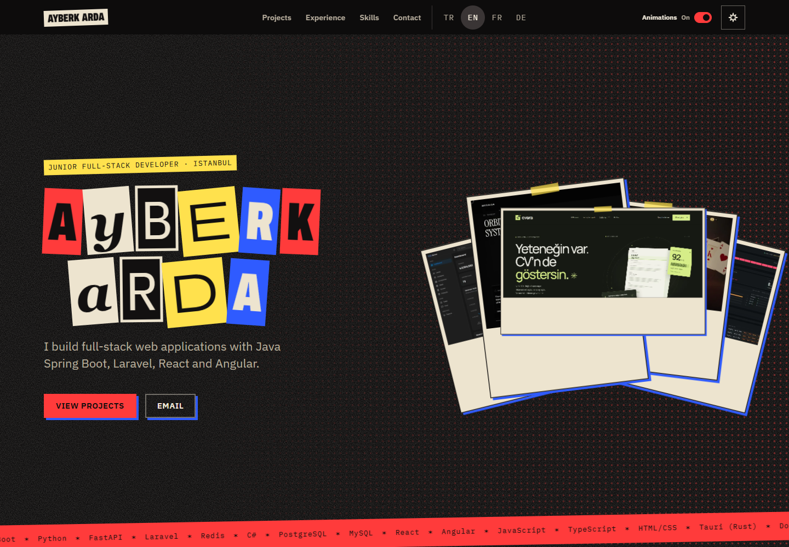
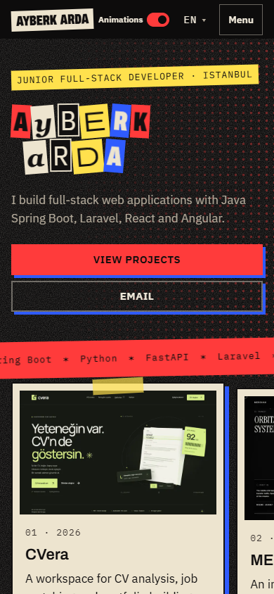
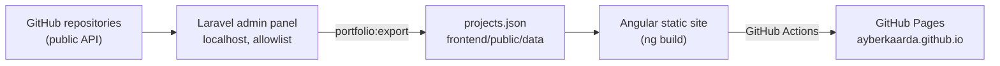

**English** | [Türkçe](README.tr.md)

# Portfolio — Ayberk Arda

Personal portfolio of Ayberk Arda, live at **https://ayberkaarda.github.io**. The public site is a static Angular application in four languages (Turkish, English, French, German) with light, dark and punk themes. The projects it shows are managed in a small Laravel admin panel that runs only on the local machine: it keeps an allowlist of GitHub repositories, holds the texts for each language and exports them to one JSON file that the site reads. GitHub Actions builds the site and publishes it to GitHub Pages.

## Screenshots

| Dark theme | Light theme |
| --- | --- |
|  |  |
|  |  |

| Mobile, dark | Mobile, light |
| --- | --- |
|  |  |

| Punk theme | Mobile, punk |
| --- | --- |
|  |  |

The public-site screenshots were captured from the current production build in English on 16 October 2026 at 1440 × 1000 (desktop) and 390 × 844 (mobile). They include the header animation switch and the newly added CVera, MERIDIAN and LearnToPoker projects. The punk-theme screenshots were added on 22 October 2026 at the same sizes.

### Project pages

| CVera | MERIDIAN |
| --- | --- |
|  |  |

| LearnToPoker | MediMind AI |
| --- | --- |
|  |  |


The portfolio currently lists 14 projects. CVera, MERIDIAN and LearnToPoker each have highlights and eight detailed sections in all four site languages, covering features, architecture, interaction, accessibility and limitations. LearnToPoker retains a prominent warning about gambling and explains that the application uses virtual chips without real-money play. MediMind AI uses its updated dark-theme home screenshot.

### Local admin panel


The admin panel interface is in Turkish. This earlier admin screenshot is retained to illustrate the management workflow; it is not a capture of the current public project list.

## Features

**Public site (`frontend/`)**

- Angular 22 with standalone components and signals; no server side at runtime.
- Four languages under `/tr/`, `/en/`, `/fr/`, `/de/`. The root path `/` redirects to the saved choice, then to the browser language, then to English.
- Light, dark and punk themes, chosen from a three-option menu in the header (a button group in the mobile menu). The theme follows the system setting (light or dark) until the visitor picks one; an inline script applies it before the first paint.
- The punk theme is a zine collage inspired by the Spider-Verse films: photocopy grain, halftone dots, the name in cut-out letters, taped paper cards, a torn-paper Experience band and stepped low-frame-rate jitter. It uses the existing self-hosted Archivo variable font, and its jitter stops when animations are off.
- An accessible animation on/off switch in the desktop and mobile header. It follows the system motion preference until the visitor explicitly chooses on or off. That choice overrides the system setting, is saved locally and stays consistent across project pages; the footer no longer contains a motion control.
- Home page sections: hero, projects, experience, skills, contact.
- On wide screens, the featured project cards start as a fan in the hero and move into the project grid while scrolling. The scene code is a separate lazy chunk and is not loaded on narrow screens or with reduced motion.
- A page per project (`/<lang>/projects/<slug>/`) with summary, image, stack, links, highlights, optional detail sections and previous/next navigation.
- Page title, description, canonical URL and `hreflang` links are set per language.

**Admin panel (`backend/`)**

- Laravel 12 with SQLite and Blade views. Runs on localhost only.
- Lists the account's public GitHub repositories. A new repository is not added to the site on its own; it must be added in the panel and is hidden until marked visible.
- Per project: visible, featured and work-in-progress flags, order, year, stack, and name, summary, description, highlights and details in four languages.
- `php artisan portfolio:export` writes the visible projects to `frontend/public/data/projects.json`.
- Optional **Publish** button that commits and pushes only that file. It is off by default.

## Architecture



The panel reads the public repository list without a token, so private repositories can never appear in it. The site has no backend: everything it shows comes from `projects.json` and the files in `frontend/public/`.

## Project structure

```
.
├── .github/workflows/deploy.yml   Build, validate and publish to GitHub Pages
├── backend/                       Laravel 12 admin panel (local only)
│   ├── app/
│   │   ├── Console/Commands/PortfolioExport.php   portfolio:export
│   │   ├── Http/Controllers/Admin/                login, projects, export, publish
│   │   ├── Http/Middleware/                       LocalOnly, TrustNoProxies, SecurityHeaders
│   │   ├── Services/GitHubRepos.php               public repository list
│   │   └── Support/                               DetailParser, ExportTarget
│   ├── config/portfolio.php       PORTFOLIO_* settings
│   ├── database/seeders/          initial projects and admin user
│   ├── resources/views/admin/     panel views
│   └── tests/                     PHPUnit feature and unit tests
├── docs/screenshots/              images used in this README
└── frontend/                      Angular 22 public site
    ├── assets-src/projects/       original project screenshots (not published)
    ├── public/
    │   ├── data/projects.json     written by the panel export
    │   └── projects/              WebP images (full size and thumbnails)
    ├── scripts/optimize-images.mjs
    └── src/
        ├── app/                   pages, sections, services, i18n
        └── styles/                design tokens and partials
```

## Getting started

Requirements: Node.js 22 and npm for the site; PHP 8.2+ and Composer for the panel.

### Site

```bash
cd frontend
npm ci
npm start          # http://localhost:4200
```

After changing the originals in `frontend/assets-src/projects/`, regenerate the WebP files with `node scripts/optimize-images.mjs` (run inside `frontend/`).

### Admin panel

```bash
cd backend
composer install
cp .env.example .env
php artisan key:generate
php artisan migrate --seed     # creates the admin user; a generated password is printed once
php artisan serve              # http://localhost:8000/admin
```

Optional settings in `backend/.env`:

| Key | Default | Meaning |
| --- | --- | --- |
| `ADMIN_EMAIL` | owner's address | Admin user created by the seeder |
| `ADMIN_PASSWORD` | empty | Admin password; when empty, a random one is generated and printed once |
| `PORTFOLIO_GITHUB_USER` | `ayberkaarda` | GitHub account whose public repositories are listed |
| `PORTFOLIO_EXPORT_PATH` | `../frontend/public/data/projects.json` | Export file; must resolve inside the repository |
| `PORTFOLIO_PUBLISH_ENABLED` | `false` | Shows the **Publish** button (git commit + push) |
| `PORTFOLIO_PUBLISH_BRANCH` | `main` | Branch that **Publish** pushes to |
| `PORTFOLIO_REPO_ROOT` | `..` | Repository root used by export and publish |
| `PORTFOLIO_ALLOW_REMOTE_ADMIN` | `false` | Allows non-local requests to the panel; keep it off |

## Admin panel and publishing workflow

The panel buttons are labelled in Turkish; their English meaning is given first.

1. **Save** (*Kaydet*). Edit a project and save it. Changes stay in the panel database.
2. **Export** (*Dışa aktar (projects.json)*). Runs `portfolio:export`. It fetches a fresh public repository list, skips projects whose repository is not public, and writes only visible projects. For offline local work, `php artisan portfolio:export --allow-unverified` skips the check.
3. **Publish** (*Yayınla (commit + push)*). Shown only with `PORTFOLIO_PUBLISH_ENABLED=true`. It exports again, commits `frontend/public/data/projects.json` and pushes it. The push starts the deploy workflow.

Repositories added on GitHub never appear on the site by themselves. The panel lists them as available; once added, a project is hidden until it is marked visible and exported.

## Project details format

Each language has an optional **Details** field (up to 6000 characters) that uses a small markdown-like grammar:

- A line starting with `## ` starts a new section with that heading.
- Non-empty lines separated by blank lines are paragraphs; lines of one paragraph are joined with a space.
- Consecutive lines starting with `- ` form a bullet list.
- Nothing else is interpreted. HTML, bold text or links stay plain text.
- Text before the first heading becomes an untitled introduction.

```text
## Overview
Inertia is a sprint and task board for small teams.

## What it does
- Manages sprints and tasks.
- Offers 1:1 chat.
```

The export converts this text to `texts.<lang>.sections` on the server; the raw text is not written to the JSON file. The project page shows highlights followed by these sections. When sections are present, they replace the plain description; otherwise the description is shown. The LearnToPoker warning remains visible above its screenshot.

## Deployment

`.github/workflows/deploy.yml` runs on pushes to `main` that change `frontend/**` or the workflow itself, and on manual dispatch. It:

1. validates `frontend/public/data/projects.json` (slugs, repository URLs, texts in all four languages, detail section structure, referenced images);
2. installs with `npm ci --ignore-scripts` and builds with `npx ng build`;
3. checks that the published copy of `projects.json` is byte-identical to the validated source;
4. copies `index.html` to `404.html` and to every language and project route, so known URLs return HTTP 200;
5. uploads the output and deploys it to GitHub Pages.

Third-party actions are pinned to commit SHAs, and each job requests only the permissions it needs.

To publish as a user site, the repository must be named `ayberkaarda.github.io`, and **Settings → Pages → Source** must be set to **GitHub Actions**.

## Testing

```bash
cd backend
php artisan test       # 54 passed, 1 skipped (259 assertions)

cd frontend
npx ng build           # production build
```

The production build for the October 2026 motion fix reports an estimated initial transfer size of 91.39 kB.

## Security notes

- The panel is for localhost only. Requests are accepted only from `127.0.0.1` or `::1`. Do not expose it to the internet or through a tunnel.
- No proxy is trusted: `X-Forwarded-For` and similar headers never change the client IP, host or scheme.
- Login is rate limited (6 attempts per minute). Responses carry a restrictive Content Security Policy, `X-Frame-Options: DENY`, `X-Content-Type-Options: nosniff` and `Referrer-Policy: no-referrer`.
- **Publish** is refused unless all of these hold:
  - `PORTFOLIO_PUBLISH_ENABLED` is true;
  - the export path is exactly `frontend/public/data/projects.json` under the repository root, with no links;
  - the branch name is a plain name;
  - a fresh public repository list is available and contains every repository in the panel;
  - the working tree has no changes other than `projects.json`;
  - `origin/<branch>` exists and there are no unpushed local commits.
  
  It then commits only that file. Failure logs contain a short summary with credentials masked, never raw command output.
- If the panel is ever served by a PHP setup outside `php artisan serve`, set `expose_php = Off` in `php.ini`. Otherwise PHP itself may add an `X-Powered-By` header.

## Accessibility and performance

- `prefers-reduced-motion` is respected: transitions are set to zero, the scroll scene and page view transitions are skipped, and the hero shows a still image stack instead. A *Reduce motion* switch in the footer does the same and is remembered.
- Keyboard use: a skip link moves focus to the content, every interactive element has a visible focus ring, and the project page moves focus to its heading.
- Text contrast is computed from the theme tokens. The lowest text-on-background ratio in any theme is 5.0:1, above WCAG AA for normal text.
- Project images are served as WebP: 1600 px for project pages, 720 px thumbnails for the home page.
- Fonts are self-hosted from the build. There is no analytics, no cookies and no third-party request; theme, language and motion choices are kept in `localStorage`.

## License

Licensed under either of

- Apache License, Version 2.0 ([LICENSE-APACHE](LICENSE-APACHE) or https://www.apache.org/licenses/LICENSE-2.0)
- MIT license ([LICENSE-MIT](LICENSE-MIT) or https://opensource.org/licenses/MIT)

at your option.

Unless you explicitly state otherwise, any contribution intentionally submitted for inclusion in this work by you, as defined in the Apache-2.0 license, shall be dual licensed as above, without any additional terms or conditions.

The license covers the source code only. Project screenshots, project descriptions and other personal content belong to their owner and are not licensed for reuse.

### Third-party

The fonts Archivo, IBM Plex Sans and IBM Plex Mono are bundled through `@fontsource` packages and are licensed under the SIL Open Font License 1.1. Other dependencies are covered by their own licenses.
