[English](README.md) | **Türkçe**

# Portfolio — Ayberk Arda

Ayberk Arda'nın kişisel portfolyo sitesi; canlı adres **https://ayberkaarda.github.io**. Herkese açık site, dört dilde (Türkçe, İngilizce, Fransızca, Almanca), açık ve koyu temalı statik bir Angular uygulamasıdır. Sitede gösterilen projeler yalnızca yerel makinede çalışan küçük bir Laravel yönetim panelinden yönetilir: panel GitHub depoları için bir izin listesi tutar, her dildeki metinleri saklar ve bunları sitenin okuduğu tek bir JSON dosyasına aktarır. GitHub Actions siteyi derleyip GitHub Pages'te yayınlar.

## Ekran görüntüleri

| Koyu tema | Açık tema |
| --- | --- |
| 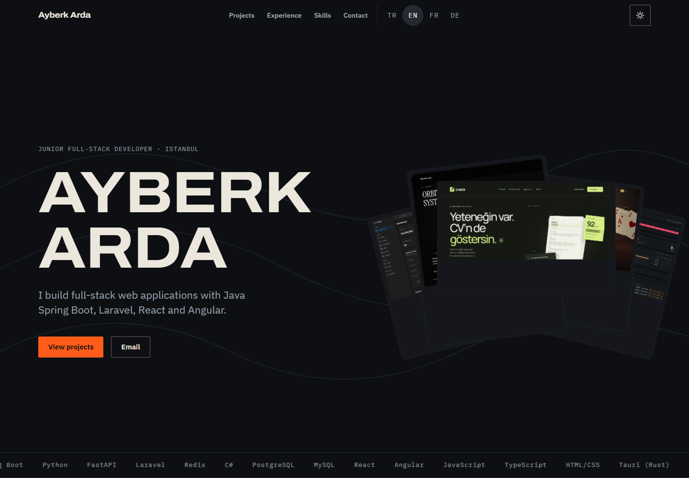 | 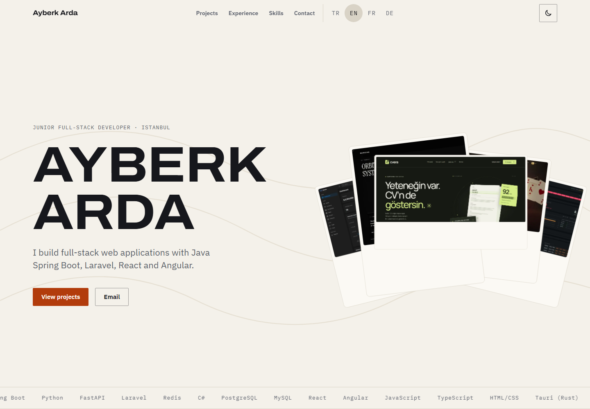 |
| 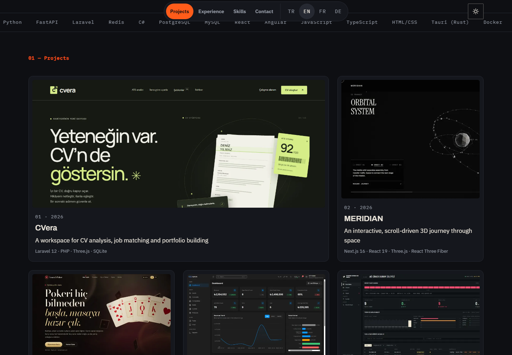 | 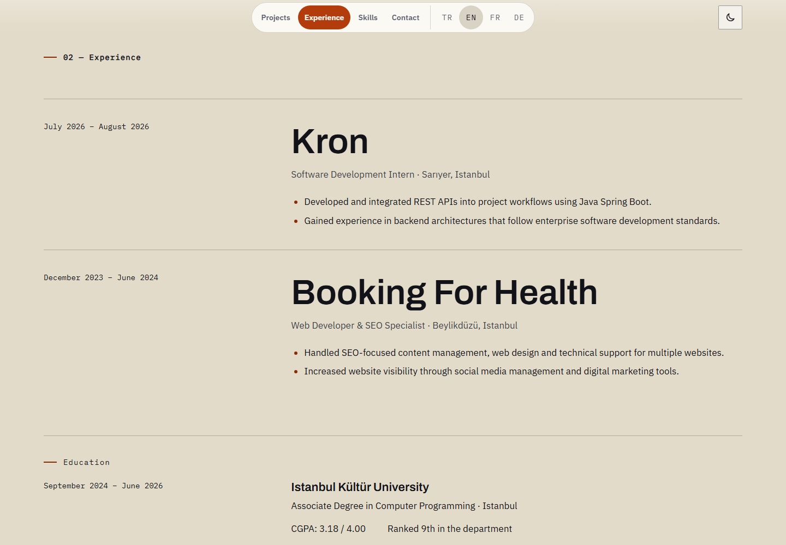 |

| Mobil, koyu | Mobil, açık |
| --- | --- |
| 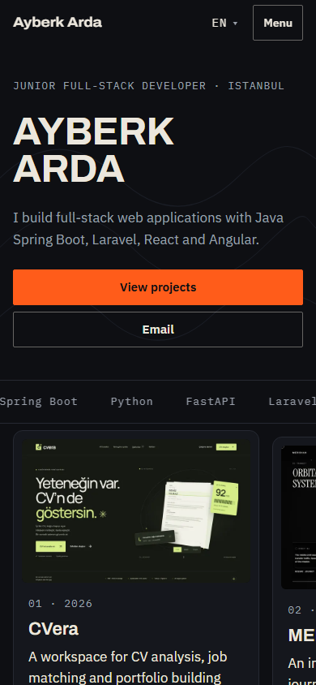 | 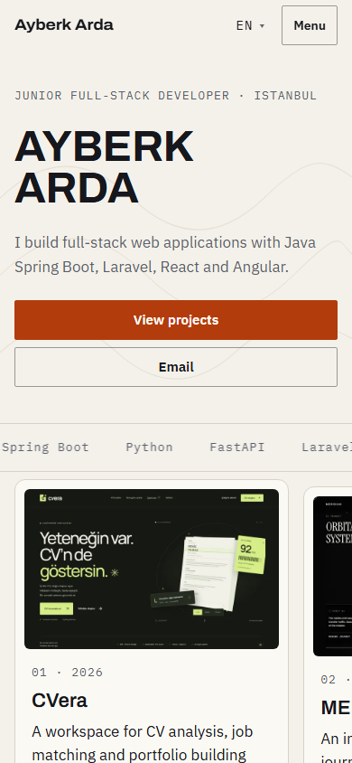 |

Herkese açık site ekran görüntüleri, 16 Ekim 2026 tarihinde canlı sitenin İngilizce sürümünden 1440 × 1000 (masaüstü) ve 390 × 844 (mobil) boyutlarında alınmıştır. Görseller yeni eklenen CVera, MERIDIAN ve LearnToPoker projelerini içerir.

### Proje sayfaları

| CVera | MERIDIAN |
| --- | --- |
| 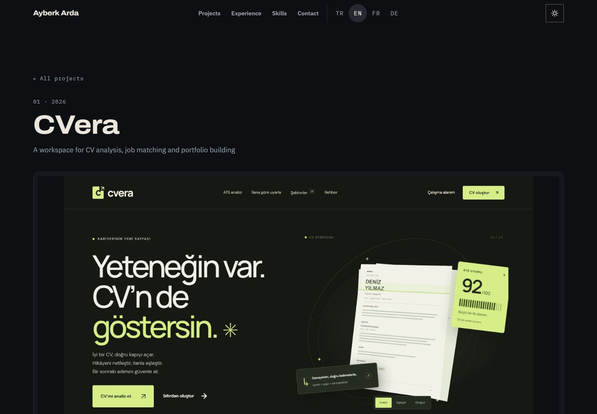 | 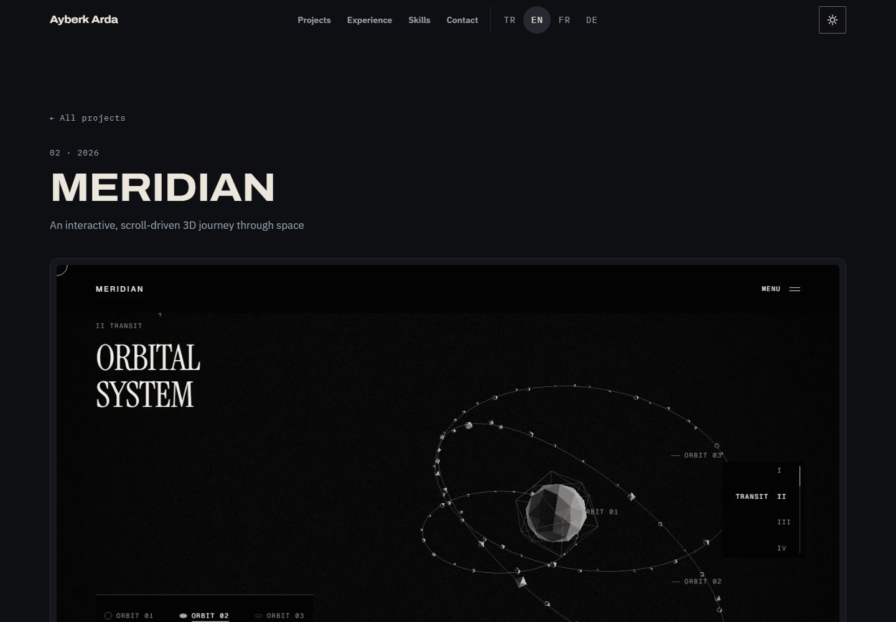 |

| LearnToPoker | MediMind AI |
| --- | --- |
| 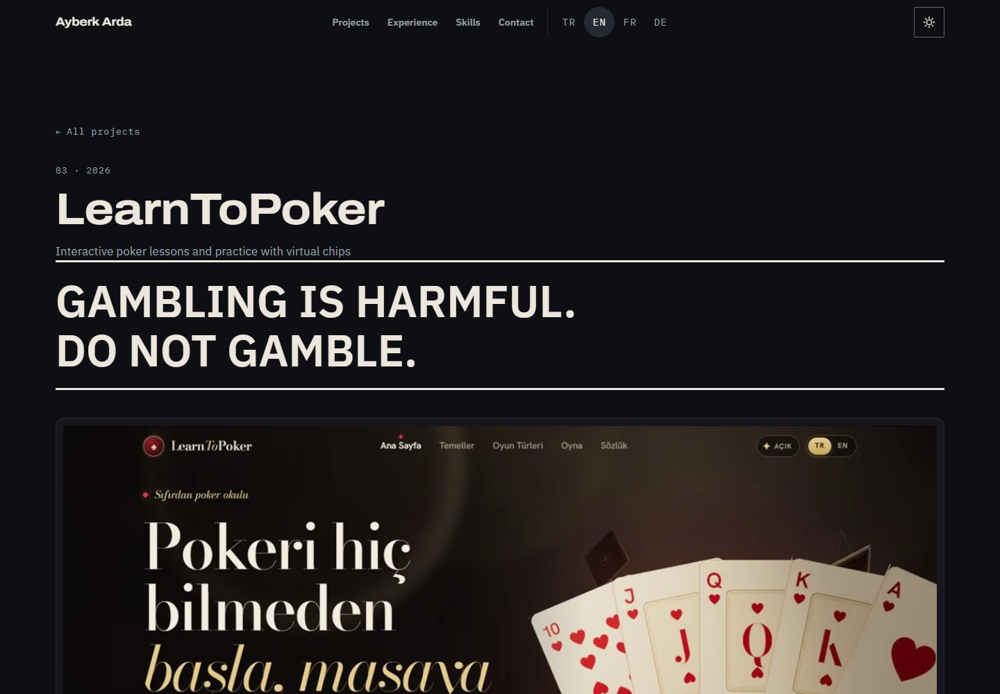 | 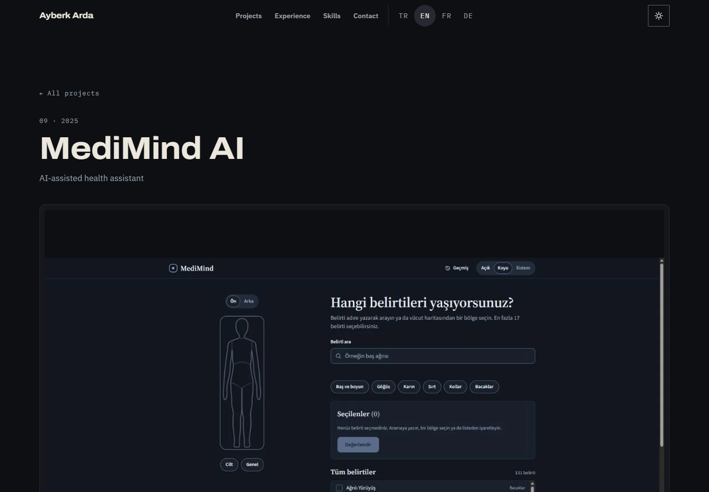 |

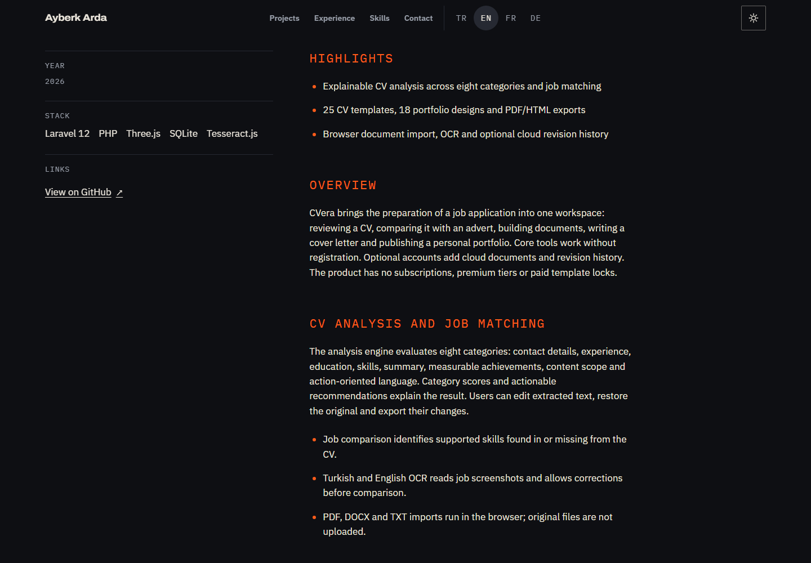

Portfolyoda şu anda 14 proje listelenir. CVera, MERIDIAN ve LearnToPoker için sitenin dört dilinde öne çıkanlar ve sekizer ayrıntılı bölüm bulunur; özellikler, mimari, etkileşim, erişilebilirlik ve sınırlar açıklanır. LearnToPoker sayfasında büyük kumar uyarısı korunur ve uygulamanın gerçek para içermeyen sanal fişlerle çalıştığı belirtilir. MediMind AI görseli yenilenen koyu tema ana ekranını gösterir.

### Yerel yönetim paneli

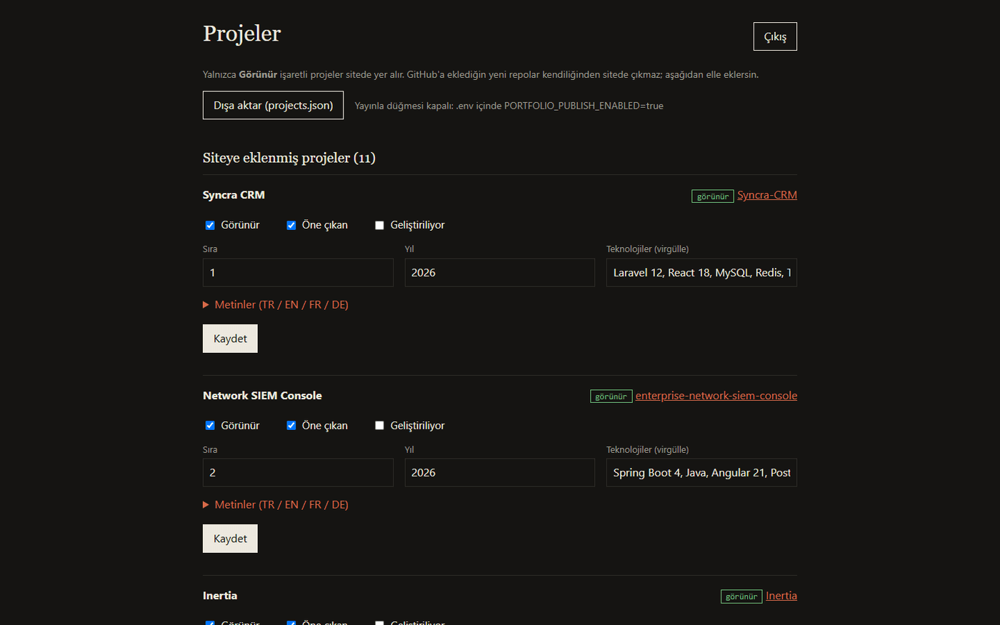

Yönetim panelinin arayüzü Türkçedir. Bu önceki panel görüntüsü yönetim akışını göstermek için korunmuştur; herkese açık sitenin güncel proje listesini göstermez.

## Özellikler

**Herkese açık site (`frontend/`)**

- Angular 22, bağımsız (standalone) bileşenler ve sinyaller; çalışma anında sunucu tarafı yok.
- `/tr/`, `/en/`, `/fr/`, `/de/` altında dört dil. Kök yol `/` önce kaydedilmiş seçime, sonra tarayıcı diline, hiçbiri yoksa İngilizceye yönlendirir.
- Açık ve koyu tema. Ziyaretçi seçim yapana kadar tema sistem ayarını izler; satır içi bir betik temayı ilk boyamadan önce uygular.
- Ana sayfa bölümleri: giriş, projeler, deneyim, yetenekler, iletişim.
- Geniş ekranlarda öne çıkan proje kartları girişte yelpaze olarak başlar ve kaydırdıkça proje ızgarasına yerleşir. Sahne kodu ayrı, tembel yüklenen bir parçadır; dar ekranlarda ve hareket azaltma tercihinde yüklenmez.
- Her proje için bir sayfa (`/<dil>/projects/<slug>/`): özet, görsel, teknolojiler, bağlantılar, öne çıkanlar, isteğe bağlı detay bölümleri ve önceki/sonraki gezinmesi.
- Sayfa başlığı, açıklama, kanonik adres ve `hreflang` bağlantıları dile göre ayarlanır.

**Yönetim paneli (`backend/`)**

- Laravel 12, SQLite ve Blade görünümleri. Yalnızca localhost üzerinde çalışır.
- Hesabın herkese açık GitHub depolarını listeler. Yeni bir depo siteye kendiliğinden eklenmez; panelden eklenmesi gerekir ve görünür yapılana kadar gizli kalır.
- Proje başına: görünür, öne çıkan ve geliştiriliyor işaretleri, sıra, yıl, teknolojiler; dört dilde ad, özet, açıklama, öne çıkanlar ve detay.
- `php artisan portfolio:export` görünür projeleri `frontend/public/data/projects.json` dosyasına yazar.
- İsteğe bağlı **Yayınla** düğmesi yalnızca bu dosyayı commit edip push eder. Varsayılan olarak kapalıdır.

## Mimari

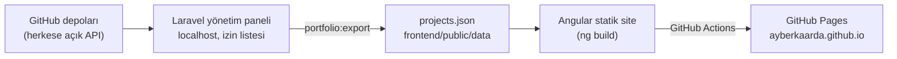

Panel herkese açık depo listesini belirteç (token) kullanmadan okur; bu yüzden özel depolar listede hiçbir zaman görünmez. Sitenin arka ucu yoktur: gösterdiği her şey `projects.json` dosyasından ve `frontend/public/` altındaki dosyalardan gelir.

## Proje yapısı

```
.
├── .github/workflows/deploy.yml   Derleme, doğrulama ve GitHub Pages yayını
├── backend/                       Laravel 12 yönetim paneli (yalnızca yerel)
│   ├── app/
│   │   ├── Console/Commands/PortfolioExport.php   portfolio:export
│   │   ├── Http/Controllers/Admin/                giriş, projeler, dışa aktarım, yayın
│   │   ├── Http/Middleware/                       LocalOnly, TrustNoProxies, SecurityHeaders
│   │   ├── Services/GitHubRepos.php               herkese açık depo listesi
│   │   └── Support/                               DetailParser, ExportTarget
│   ├── config/portfolio.php       PORTFOLIO_* ayarları
│   ├── database/seeders/          ilk projeler ve yönetici kullanıcı
│   ├── resources/views/admin/     panel görünümleri
│   └── tests/                     PHPUnit özellik ve birim testleri
├── docs/screenshots/              bu README'deki görseller
└── frontend/                      Angular 22 herkese açık site
    ├── assets-src/projects/       özgün proje ekran görüntüleri (yayınlanmaz)
    ├── public/
    │   ├── data/projects.json     panelin ürettiği dosya
    │   └── projects/              WebP görseller (tam boy ve küçük)
    ├── scripts/optimize-images.mjs
    └── src/
        ├── app/                   sayfalar, bölümler, servisler, i18n
        └── styles/                tasarım değişkenleri ve parçalar
```

## Başlarken

Gereksinimler: site için Node.js 22 ve npm; panel için PHP 8.2+ ve Composer.

### Site

```bash
cd frontend
npm ci
npm start          # http://localhost:4200
```

`frontend/assets-src/projects/` altındaki özgün görseller değişirse WebP dosyalarını `frontend/` içinde `node scripts/optimize-images.mjs` ile yeniden üretin.

### Yönetim paneli

```bash
cd backend
composer install
cp .env.example .env
php artisan key:generate
php artisan migrate --seed     # yönetici kullanıcıyı oluşturur; üretilen parola bir kez yazdırılır
php artisan serve              # http://localhost:8000/admin
```

`backend/.env` içindeki isteğe bağlı ayarlar:

| Anahtar | Varsayılan | Anlamı |
| --- | --- | --- |
| `ADMIN_EMAIL` | sahibin adresi | Seed sırasında oluşturulan yönetici |
| `ADMIN_PASSWORD` | boş | Yönetici parolası; boşsa rastgele üretilir ve bir kez yazdırılır |
| `PORTFOLIO_GITHUB_USER` | `ayberkaarda` | Herkese açık depoları listelenen GitHub hesabı |
| `PORTFOLIO_EXPORT_PATH` | `../frontend/public/data/projects.json` | Dışa aktarım dosyası; depo içinde kalmalıdır |
| `PORTFOLIO_PUBLISH_ENABLED` | `false` | **Yayınla** düğmesini gösterir (git commit + push) |
| `PORTFOLIO_PUBLISH_BRANCH` | `main` | **Yayınla**'nın push ettiği dal |
| `PORTFOLIO_REPO_ROOT` | `..` | Dışa aktarım ve yayının kullandığı depo kökü |
| `PORTFOLIO_ALLOW_REMOTE_ADMIN` | `false` | Panele yerel olmayan isteklere izin verir; kapalı tutun |

## Yönetim paneli ve yayın akışı

1. **Kaydet.** Projeyi düzenleyip kaydedin. Değişiklikler panel veritabanında kalır.
2. **Dışa aktar (projects.json).** `portfolio:export` komutunu çalıştırır. Güncel herkese açık depo listesini çeker, deposu herkese açık olmayan projeleri atlar ve yalnızca görünür projeleri yazar. Çevrimdışı yerel çalışmada `php artisan portfolio:export --allow-unverified` bu denetimi atlar.
3. **Yayınla (commit + push).** Yalnızca `PORTFOLIO_PUBLISH_ENABLED=true` iken görünür. Yeniden dışa aktarır, `frontend/public/data/projects.json` dosyasını commit eder ve push eder. Push, yayın iş akışını başlatır.

GitHub'a eklenen depolar sitede kendiliğinden görünmez. Panel bunları eklenebilir olarak listeler; eklenen proje görünür yapılıp dışa aktarılana kadar gizli kalır.

## Proje detayları biçimi

Her dilde isteğe bağlı bir **Detay** alanı vardır (en fazla 6000 karakter). Alan küçük, markdown benzeri bir dilbilgisi kullanır:

- `## ` ile başlayan satır, o başlıkla yeni bir bölüm açar.
- Boş satırla ayrılan dolu satırlar paragraftır; bir paragrafın satırları boşlukla birleştirilir.
- `- ` ile başlayan ardışık satırlar madde listesidir.
- Başka hiçbir şey yorumlanmaz. HTML, kalın yazı ya da bağlantı düz metin kalır.
- İlk başlıktan önceki metin başlıksız bir giriş olur.

```text
## Genel bakış
Inertia küçük ekipler için bir sprint ve görev panosudur.

## Neler yapar
- Sprintleri ve görevleri yönetir.
- Bire bir sohbet sunar.
```

Dışa aktarım bu metni sunucuda `texts.<dil>.sections` dizisine çevirir; ham metin JSON dosyasına yazılmaz. Proje sayfası öne çıkanlardan sonra detay bölümlerini gösterir. Bölümler varsa düz açıklamanın yerini alır; yoksa açıklama gösterilir. LearnToPoker uyarısı ekran görüntüsünün üzerinde görünür kalır.

## Yayın

`.github/workflows/deploy.yml`, `main` dalına `frontend/**` ya da iş akışının kendisini değiştiren push'larda ve elle tetiklemede çalışır. Sırasıyla:

1. `frontend/public/data/projects.json` dosyasını doğrular (slug'lar, depo adresleri, dört dildeki metinler, detay bölümlerinin yapısı, başvurulan görseller);
2. `npm ci --ignore-scripts` ile kurar ve `npx ng build` ile derler;
3. yayınlanan `projects.json` kopyasının doğrulanan kaynakla bayt bayt aynı olduğunu denetler;
4. `index.html` dosyasını `404.html` olarak ve her dil ile proje yoluna kopyalar; böylece bilinen adresler HTTP 200 döner;
5. çıktıyı yükleyip GitHub Pages'e dağıtır.

Üçüncü taraf eylemler commit SHA'larına sabitlenmiştir; her iş yalnızca gereken izinleri ister.

Kullanıcı sitesi olarak yayın için depo adı `ayberkaarda.github.io` olmalı ve **Settings → Pages → Source** değeri **GitHub Actions** seçilmelidir. GitHub Pages herkese açık depolarda ücretsizdir.

## Testler

```bash
cd backend
php artisan test       # 54 başarılı, 1 atlanan (259 doğrulama)

cd frontend
npx ng build           # üretim derlemesi
```

Ekim 2026 proje güncellemesinin üretim derlemesi, ilk yükleme için tahmini aktarım boyutunu 91.23 kB olarak bildirir.

## Güvenlik notları

- Panel yalnızca localhost içindir. İstekler yalnızca `127.0.0.1` ya da `::1` adresinden kabul edilir. Paneli internete ya da bir tünele açmayın.
- Hiçbir proxy'ye güvenilmez: `X-Forwarded-For` ve benzeri başlıklar istemci IP'sini, sunucu adını ya da şemayı değiştirmez.
- Giriş hız sınırlıdır (dakikada 6 deneme). Yanıtlar kısıtlayıcı bir Content Security Policy, `X-Frame-Options: DENY`, `X-Content-Type-Options: nosniff` ve `Referrer-Policy: no-referrer` taşır.
- **Yayınla** aşağıdakilerin hepsi sağlanmadıkça reddedilir:
  - `PORTFOLIO_PUBLISH_ENABLED` açıktır;
  - dışa aktarım yolu depo kökü altında tam olarak `frontend/public/data/projects.json`'dur ve bağlantı (link) içermez;
  - dal adı düz bir addır;
  - güncel herkese açık depo listesi alınabilir ve paneldeki her depoyu içerir;
  - çalışma ağacında `projects.json` dışında değişiklik yoktur;
  - `origin/<dal>` vardır ve push edilmemiş yerel commit yoktur.
  
  Ardından yalnızca bu dosya commit edilir. Hata günlükleri ham komut çıktısını değil, kimlik bilgileri maskelenmiş kısa bir özeti içerir.
- Panel `php artisan serve` dışında bir PHP ortamında sunulacaksa `php.ini` içinde `expose_php = Off` ayarlayın; aksi halde PHP kendisi `X-Powered-By` başlığını ekleyebilir.

## Erişilebilirlik ve performans

- `prefers-reduced-motion` dikkate alınır: geçiş süreleri sıfırlanır, kaydırma sahnesi ve sayfa geçişleri atlanır, girişte hareketsiz bir görsel yığını gösterilir. Alt bilgideki *Hareketi azalt* düğmesi aynı şeyi yapar ve seçim hatırlanır.
- Klavye: "İçeriğe geç" bağlantısı odağı içeriğe taşır, her etkileşimli öğenin görünür bir odak halkası vardır ve proje sayfası odağı başlığına taşır.
- Metin kontrastı tema değişkenlerinden hesaplanmıştır. İki temada da en düşük metin/arka plan oranı 5.0:1'dir; bu, normal metin için WCAG AA sınırının üzerindedir.
- Proje görselleri WebP olarak sunulur: proje sayfaları için 1600 px, ana sayfa için 720 px küçük görseller.
- Yazı tipleri derlemeyle birlikte siteden sunulur. Analitik, çerez ya da üçüncü taraf isteği yoktur; tema, dil ve hareket tercihleri `localStorage` içinde tutulur.

## Lisans

Aşağıdakilerden biri altında, tercihinize göre lisanslanmıştır:

- Apache License, Version 2.0 ([LICENSE-APACHE](LICENSE-APACHE) ya da https://www.apache.org/licenses/LICENSE-2.0)
- MIT lisansı ([LICENSE-MIT](LICENSE-MIT) ya da https://opensource.org/licenses/MIT)

Aksini açıkça belirtmediğiniz sürece, bu çalışmaya eklenmek üzere bilerek gönderdiğiniz her katkı, Apache-2.0 lisansındaki tanımıyla, ek bir koşul olmaksızın yukarıdaki gibi çift lisanslı olur.

Lisans yalnızca kaynak kodu kapsar. Proje ekran görüntüleri, proje açıklamaları ve diğer kişisel içerik sahibine aittir ve yeniden kullanım için lisanslanmamıştır.

### Üçüncü taraf

Archivo, IBM Plex Sans ve IBM Plex Mono yazı tipleri `@fontsource` paketleriyle gelir ve SIL Open Font License 1.1 altındadır. Diğer bağımlılıklar kendi lisanslarına tabidir.
